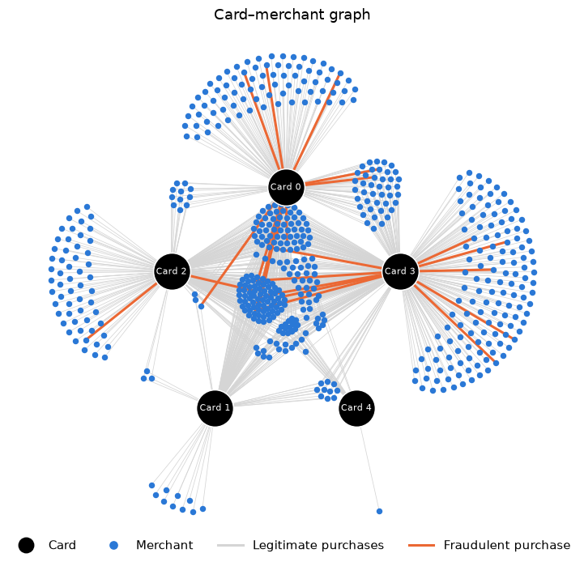

# Fraud Detection Using Graph Neural Networks

A Graph Neural Network (GNN) built with PyTorch to detect fraudulent credit-card transactions. It is compared with a standard neural network (MLP) to understand how including information about the connections between transactions can improve fraud detection.

A fraudulent transaction often looks normal on its own. It only stands out **in context**, for example an online purchase on a card that is usually swiped, or a burst of purchases at shops the card has never used. A standard model sees each transaction in isolation. A GNN learns from the **relationships between transactions**: each transaction gathers information from its neighbours, meaning the card's other recent purchases and the merchant's other recent customers, so it can spot behaviour that is out of character.

**Result:** the GNN caught **4 of 5** fraudulent test transactions, against 2 of 5 for the MLP, and raised fewer false alarms (ROC-AUC 0.997 vs 0.915).

## Dataset

The data is the [IBM synthetic credit-card transactions dataset](https://www.kaggle.com/datasets/ealtman2019/credit-card-transactions) from Kaggle. The full dataset has 24.4 million transactions (1991–2020) from 2,000 customers, 29,757 of them fraudulent. This experiment uses one customer (User 0):

| | User 0 |
|---|---|
| Transactions | 19,963 (2002–2020) |
| Cards / merchants | 5 / 552 |
| Fraudulent transactions | 27 (0.14%) |

## Exploratory Data Analysis (EDA)

Fraud is rare and arrives in **bursts**. All 27 fraudulent transactions fall in just four months, each time on a single card used several times over a few days.

Compared with legitimate spending, fraud is mostly **online** (56% against 7%) and happens during the day. Amounts look similar, and no fraudulent transaction has an error code.

The card–merchant graph shows each card's spending. Merchants in the centre are shared by several cards, while each card also has merchants only it uses. Fraudulent purchases (orange) come from cards 0, 2 and 3. They usually go to rarely used merchants: a median of 13 visits, against 898 for legitimate purchases.



## Building the Graph

- **Nodes:** each transaction is a node with 8 features: amount, hour, swipe / chip / online, error flag, whether the merchant is new to the card, and time since the card's last transaction.
- **Edges:** each transaction is linked to the next 3 transactions on the **same card** and the next 3 at the **same merchant**.

The result is 19,963 nodes and 224,504 directed edges, about 11 neighbours per transaction. A GNN can judge each transaction against its neighbours. For example, one of the frauds sits among other online frauds from the same burst.

## Method

| Model | What it sees |
|---|---|
| MLP (baseline) | only the transaction's own features |
| GraphSAGE (GNN) | the transaction's features plus the average of its neighbours', over two layers |

- **Architecture:** both models have two hidden layers of 32 units and dropout of 0.3.
- **Training:** Adam (learning rate 0.01) for 200 epochs, keeping the epoch with the best validation ROC-AUC.
- **Split:** stratified 60 / 20 / 20 train / validation / test.
- **Imbalance:** fraud is weighted in the loss (`pos_weight` ≈ 750). Models are judged on ROC-AUC, average precision and F1, not accuracy.

## Results

| Model | ROC-AUC | Average precision | F1 | Frauds caught |
|---|---|---|---|---|
| MLP | 0.915 | 0.431 | 0.167 | 2 / 5 |
| **GraphSAGE** | **0.997** | **0.575** | **0.400** | **4 / 5** |

Random guessing would score an average precision of about 0.001.

## How to Run

```bash
python -m venv .venv
source .venv/bin/activate
pip install -r requirements.txt
jupyter notebook Fraud_Detection_GNN.ipynb
```
